# Схема CQRS в MovieTracker

Обновлено: 2026-11-11 (состояние после задачи 3.21). Схема составлена вручную по коду проекта и отражает путь запроса через mediator, который автоматический разбор кода не показывает (handler находится во время работы по типу сообщения). При изменении архитектуры схему нужно обновлять руками; интерактивная версия с таблицей соответствия учебной картинке была опубликована как артефакт в сессии Claude Code.

```mermaid
flowchart LR
    client["Клиент<br/>React-фронт: GET /movies, PATCH status<br/>остальное: прямые запросы"]

    subgraph http["Эндпоинты"]
        direction TB
        e1["PATCH /movies/{id}/status"]
        e2["PATCH /movies/{id}/notes"]
        e3["PATCH /movies/{id}/rating"]
        e4["POST /movies"]
        e5["GET /movies"]
        e6["PUT, DELETE /watchlist/{movieId}"]
    end

    subgraph med["Mediator (Mediator/)"]
        direction TB
        send["IMediator.Send"]
        timing["TimingBehavior<br/>замер времени, строка в лог"]
        send --> timing
    end

    subgraph write["Запись: Commands/"]
        direction TB
        h1["SetStatusHandler"]
        h2["SetNotesHandler<br/>заметка до 500 символов"]
        h3["SetRatingHandler<br/>оценка 0–10, не NaN"]
        h4["CreateMovieHandler<br/>дубликат: null, то есть 400"]
        writer["UserMovieDataWriter<br/>существование, найти или создать запись,<br/>сохранить с повтором при гонке"]
    end

    subgraph read["Чтение: Queries/"]
        direction TB
        h5["GetMoviesHandler<br/>фильтры, сортировка, страница"]
        reader["IWatchlistReader<br/>граница модуля"]
    end

    wl["WatchlistService<br/>(Services/)"]
    db[("PostgreSQL, одна база<br/>Movies (TitleKey), Genres, GenreMovie,<br/>Users, UserMovieData, WatchlistItems")]

    client --> http
    e1 -->|SetStatusCommand| send
    e2 -->|SetNotesCommand| send
    e3 -->|SetRatingCommand| send
    e4 -->|CreateMovieCommand| send
    e5 -->|GetMoviesQuery| send

    timing --> h1
    timing --> h2
    timing --> h3
    timing --> h4
    timing --> h5

    h1 --> writer
    h2 --> writer
    h3 --> writer
    writer -->|запись| db
    h4 -->|DbContext: вставка фильма| db
    db -->|чтение: каталог, личные данные| h5
    h5 --> reader
    reader -->|реализует| wl

    e6 -.->|в обход mediator| wl
    wl --> db

    classDef write fill:#fdf1e3,stroke:#b45309,color:#18202e
    classDef read fill:#e2f4f1,stroke:#0f766e,color:#18202e
    classDef outside fill:#f3f4f6,stroke:#6b7280,stroke-dasharray:5 4,color:#18202e
    classDef infra fill:#efe9fc,stroke:#6140b8,color:#18202e
    class e1,e2,e3,e4,h1,h2,h3,h4,writer write
    class e5,h5,reader read
    class e6,wl outside
    class send,timing infra
    style http fill:none,stroke:#9aa5b8
    style med fill:none,stroke:#ab97e3
    style write fill:none,stroke:#e5a560
    style read fill:none,stroke:#62bbb0
```

Эндпоинты описаны в `Initializer/Bootstrap.cs`. Ответ идёт тем же путём назад. Результат в код ответа переводит эндпоинт: `null` даёт 404 у `PATCH` и 400 у `POST`, исключения о неверных границах (`InvalidRatingException`, `InvalidNotesException`, `InvalidPageSizeException`) дают 400, успех даёт 200 (у `POST` 201).

## Чем проект отличается от учебной картинки «Client, Command Model, Write, Event, Read, Query Model»

| На учебной картинке | В проекте |
|---|---|
| Command Model | Команды и handler'ы в `Commands/`: `SetStatus`, `SetNotes`, `SetRating`, `CreateMovie`; три `PATCH` делят механику записи `UserMovieDataWriter` |
| Write, база | Запись через `DbContext` в PostgreSQL; уникальность фильма гарантирует индекс по ключу названия и году |
| Event | Нет. Handler'ы ничего не публикуют, события в плане этапа 3 |
| Materialized View, отдельная база чтения | Нет. Запрос читает те же таблицы, которые пишут команды |
| Query Model | `GetMoviesQuery` и `GetMoviesHandler` в `Queries/`; список watchlist handler берёт через `IWatchlistReader` |
| (нет на картинке) | Mediator с конвейером (`TimingBehavior` оборачивает каждый вызов) и watchlist (`PUT`, `DELETE`), который пока вызывает сервис напрямую |

Разделение команд и запросов в проекте сделано на уровне кода (сообщение, mediator, handler), а не на уровне хранилищ: база одна, событий нет.
