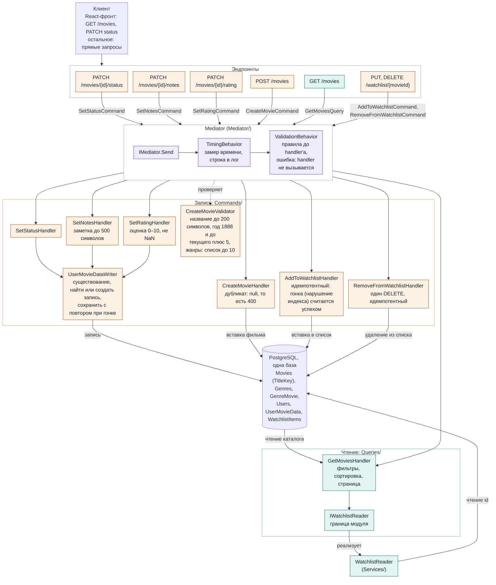

# Схема CQRS в MovieTracker

Обновлено: 2026-11-12 (состояние после задачи 3.24: watchlist ушёл в mediator). Раскладка сверху вниз: горизонтальная версия выросла до 3669 px в ширину (первая была 3060) и перестала читаться; стрелки от конвейера к handler'ам теперь выходят из рамки Mediator целиком. Схема составлена вручную по коду проекта и отражает путь запроса через mediator, который автоматический разбор кода не показывает (handler находится во время работы по типу сообщения). При изменении архитектуры схему нужно обновлять руками. Интерактивная версия с таблицей соответствия учебной картинке была опубликована как артефакт в сессии Claude Code; это снимок на состояние после задачи 3.21 (без проверки в конвейере), сам он не обновляется.

Эндпоинты описаны в `Initializer/Bootstrap.cs`. Ответ идёт тем же путём назад. Результат в код ответа переводит эндпоинт: `null` даёт 404 у `PATCH` и 400 у `POST`, исключения о неверных границах (`InvalidRatingException`, `InvalidNotesException`, `InvalidPageSizeException`) дают 400, успех даёт 200 (у `POST` 201). У `PUT` и `DELETE` watchlist ответ команды `bool`: `false` (нет фильма или пользователя) даёт 404, `true` даёт 204 без тела. Нарушение правил `POST` (`RequestValidationException` из `ValidationBehavior`) эндпоинт переводит в 400 в формате `ValidationProblemDetails`: словарь `errors` по полям `title`, `year`, `genresId`, все ошибки сразу; handler при этом не вызывается. Замер (`TimingBehavior`) стоит снаружи проверки, поэтому пишет время и для отклонённых запросов.

## Чем проект отличается от учебной картинки «Client, Command Model, Write, Event, Read, Query Model»

| На учебной картинке | В проекте |
|---|---|
| Command Model | Команды и handler'ы в `Commands/`: `SetStatus`, `SetNotes`, `SetRating`, `CreateMovie`, `AddToWatchlist`, `RemoveFromWatchlist`; три `PATCH` делят механику записи `UserMovieDataWriter`, handler'ы watchlist самостоятельны (проверку существования повторяют намеренно) |
| Write, база | Запись через `DbContext` в PostgreSQL; уникальность фильма гарантирует индекс по ключу названия и году |
| Event | Нет. Handler'ы ничего не публикуют, события в плане этапа 3 |
| Materialized View, отдельная база чтения | Нет. Запрос читает те же таблицы, которые пишут команды |
| Query Model | `GetMoviesQuery` и `GetMoviesHandler` в `Queries/`; список watchlist handler берёт через `IWatchlistReader` (граница Movies и Watchlist, реализация `WatchlistReader`); чтение watchlist остаётся вне mediator |
| (нет на картинке) | Mediator с конвейером (`TimingBehavior` оборачивает каждый вызов, `ValidationBehavior` проверяет запрос до handler'а); через него теперь идут все операции записи |

Разделение команд и запросов в проекте сделано на уровне кода (сообщение, mediator, handler), а не на уровне хранилищ: база одна, событий нет.
